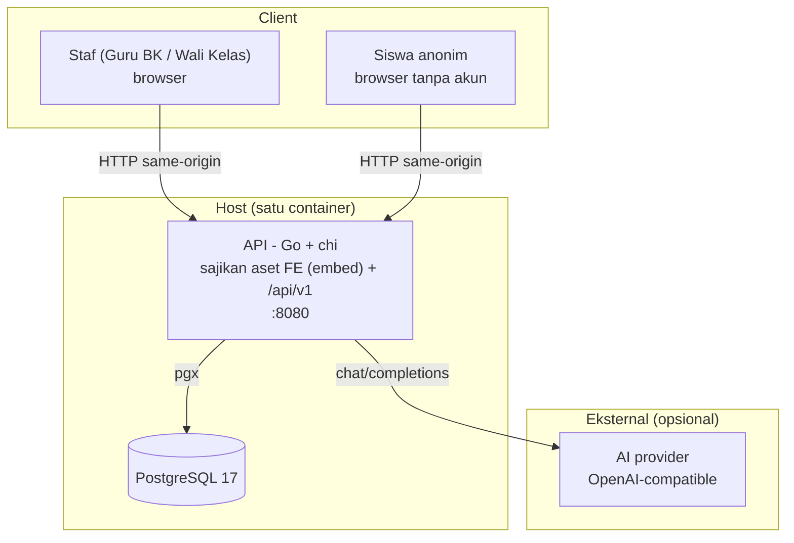
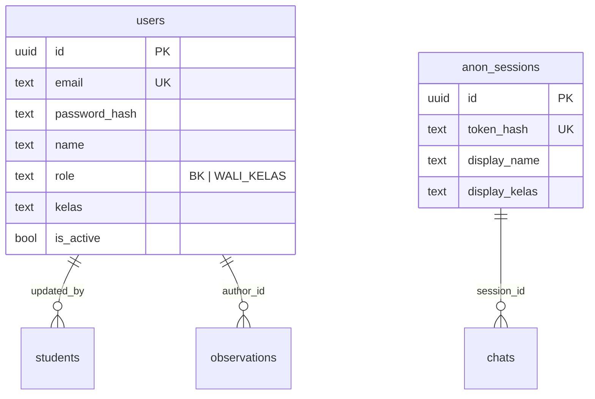
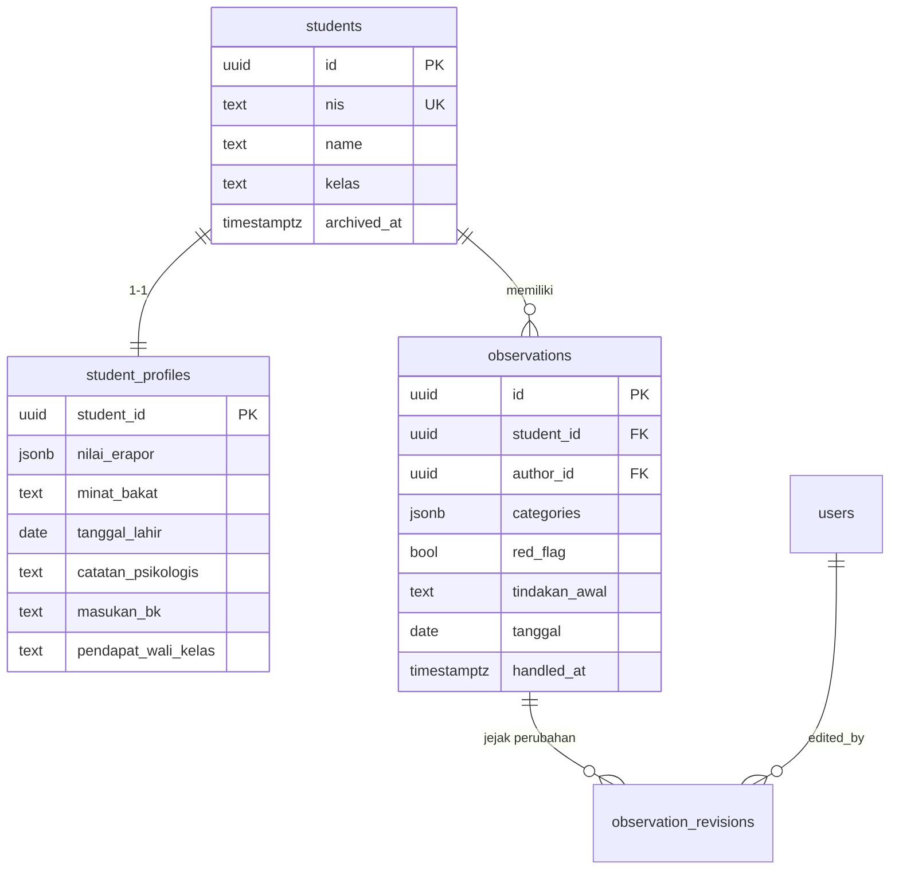
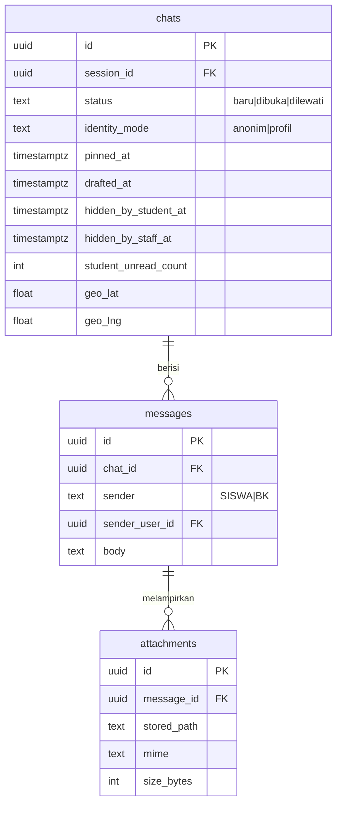
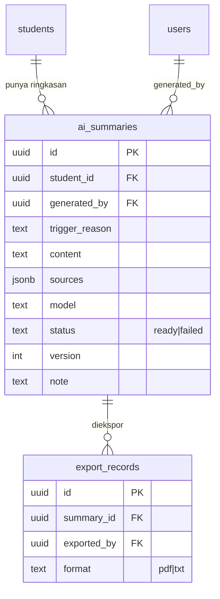

<p align="center">
  
</p>

# Understud

### Platform pendampingan siswa: laporan anonim, deteksi dini, dan ringkasan profil berbantuan AI

**Turn Anonymous Reports Into Early Support**

<p>
  
  
  
  
  
</p>

**Submission for Joints X Inspire 2026, bidang Hackathon (Tema: Education)**

**By Tim Menuju ADA 100**

---

## Daftar Isi

- [Tim Developer](#tim-developer)
- [Tentang Proyek](#tentang-proyek)
- [Fitur Unggulan](#fitur-unggulan)
- [Demo](#demo)
- [Teknologi](#teknologi)
- [Arsitektur Sistem](#arsitektur-sistem)
- [Instalasi & Setup](#instalasi--setup)
- [Penggunaan](#penggunaan)
- [API Documentation](#api-documentation)
- [Pengujian](#pengujian)
- [Lisensi](#lisensi)

---

## Tim Developer

| Nama | Peran | Tanggung Jawab |
|---|---|---|
| **Juan Kevin Utomo** | Project Manager | Koordinasi tim, manajemen tugas, video project |
| **Fazril Syaveral Hillaby** | Full-stack Developer | Backend Go, frontend React, infrastruktur & deploy |
| **Benard Dimitri Tasidjawa** | UI/UX Designer | Riset pengguna, design system, prototipe antarmuka |
| **Tony Cung** | Business Analyst (Pitch Lead) | Pitch deck, pitching, validasi bisnis & go-to-market |

---

## Tentang Proyek

### Latar Belakang

Wali Kelas dan Guru BK membutuhkan cara cepat untuk menemukan serta memahami siswa yang memerlukan pendampingan. Namun waktu mereka tersita administrasi, sementara sinyal risiko siswa tersebar di banyak tempat dan sering tidak terdeteksi. Siswa yang paling butuh bantuan justru paling enggan melapor, karena takut identitasnya diketahui atau malas membuat akun baru.

Kami mengangkat **tiga subtema** dari bidang Education:

1. **Siswa berisiko putus sekolah** - kehilangan motivasi karena faktor ekonomi, ikut membantu keluarga bekerja, pernikahan dini, atau lingkungan yang tidak mendukung.
2. **Siswa kelas akhir yang bingung arah** - kesulitan menentukan jurusan, memilih jalur pendidikan, dan merencanakan karier sesuai minat serta kemampuan.
3. **Guru yang kehabisan waktu** - guru honorer, guru kelas gabungan, dan dosen yang waktunya habis untuk administrasi sehingga waktu mendampingi siswa berkurang.

### Solusi yang Ditawarkan

- **Kanal laporan anonim tanpa akun.** Siswa bisa bercerita dengan aman lewat `/lapor`, tanpa daftar, tanpa akun, identitas opsional.
- **Triase laporan untuk Guru BK.** Antrean laporan dengan pin, draft, dan lewati, sehingga kasus mendesak bisa diprioritaskan lebih dulu.
- **Ringkasan profil berbantuan AI.** Data akademik dan observasi dirangkum untuk mempercepat persiapan pendampingan, bukan diagnosis dan bukan keputusan otomatis.

Intinya: satu alur kerja guru untuk **laporan anonim, deteksi dini, dan ringkasan profil siswa**, tanpa mewajibkan siswa membuat akun.

### Tujuan Proyek

- Membuka kanal laporan siswa tanpa hambatan akun.
- Memudahkan Guru BK meninjau, menyimpan, dan menindaklanjuti laporan.
- Menggabungkan data akademik dan observasi ke dalam ringkasan profil siswa.
- Menandai indikator risiko untuk **ditinjau manusia**, bukan menetapkan diagnosis.

### Batasan Produk

Ringkasan AI bersifat **pendukung keputusan**, bukan pengganti penilaian profesional. Sistem tidak memberikan diagnosis psikologis, tidak menghitung skor risiko otomatis, dan selalu menampilkan sumber data yang dipakai. Keputusan akhir dan tindak lanjut tetap berada pada guru.

Sistem juga tidak menjanjikan anonimitas absolut terhadap metadata jaringan. UI menampilkan kanal bantuan dan batas kemampuan layanan untuk laporan yang bersifat darurat.

---

## Fitur Unggulan

### Fitur Utama

| Fitur | Deskripsi | Keunggulan |
|---|---|---|
| **Anonymous Chat** | Siswa mengirim laporan tanpa akun; Guru BK meninjau lewat antrean dengan aksi Pin, Draft, dan Lewati. | Menghapus hambatan melapor sekaligus memberi BK alur triase yang rapi. |
| **AI Profile Summary** | Merangkum nilai E-Rapor, observasi, dan catatan guru menjadi gambaran kekuatan & kebutuhan siswa. | Memangkas waktu pengumpulan konteks sebelum sesi pendampingan. |

### Fitur Pendukung

- **Login & Kontrol Akses**: dua peran (Guru BK, Wali Kelas) dengan pembatasan data sesuai cakupan.
- **Checklist Deteksi Dini**: tujuh kategori indikator observasi dengan penanda **red flag** untuk eskalasi segera ke BK.
- **Riwayat Versi Ringkasan**: setiap ringkasan tercatat pembuat, waktu, dan versinya.
- **Impor Leger E-Rapor**: unggah Excel/CSV, pratinjau, lalu commit, tanpa input manual satu per satu.
- **Ekspor Ringkasan (PDF/TXT)**: unduh ringkasan untuk rapat pendampingan, dengan pencatatan jejak ekspor.
- **Lampiran Gambar**: siswa dapat menyertakan gambar pada laporan dengan validasi format & ukuran.
- **Audit Lokasi (opsional)**: pencatatan koordinat saat laporan dikirim, mendukung geofence bila diaktifkan sekolah.

---

## Demo

**Live Demo:** https://understud.fazrilsh.com

**Video Demo:** menyusul.

---

## Teknologi

### Tech Stack

```
Frontend
  bahasa        : TypeScript
  framework     : React 19 + Vite 8
  routing       : React Router 7
  server-state  : TanStack Query v5
  ui-state      : zustand
  styling       : Tailwind CSS v4 + shadcn
  http          : axios (baseURL /api/v1, withCredentials)
  notifikasi    : sonner

Backend
  bahasa        : Go 1.26
  router        : chi v5
  database      : PostgreSQL 17
  db access     : pgx v5 + sqlc (SQL-first, type-safe)
  migrasi       : goose (embedded, auto-run saat start)
  auth          : JWT HS256 httpOnly cookie (tanpa refresh token)
  pdf           : go-pdf/fpdf
  excel         : excelize v2
  logging       : log/slog (JSON ke stdout)

DevOps & Tools
  kontainer     : Docker multi-stage (satu image: FE ter-embed di binary Go)
  orchestrasi   : docker-compose
  kontrak api   : OpenAPI 3 (hand-maintained) -> gen types via openapi-typescript
```

### Alasan Pemilihan Teknologi

| Teknologi | Alasan Pemilihan |
|---|---|
| **Go + chi** | Binary tunggal, startup cepat, mudah di-deploy. `net/http`-compatible dengan middleware idiomatik. |
| **pgx + sqlc** | SQL-first dan type-safe. Query ditulis manual, kode Go di-generate. Cocok untuk agregasi dashboard yang kompleks. |
| **goose embedded** | Migrasi ikut ter-embed di binary dan auto-run saat startup, jadi `docker-compose up -d` selalu cukup untuk jalan. |
| **JWT httpOnly cookie** | Token tidak bisa dibaca JavaScript sehingga lebih tahan XSS; same-origin via proxy menghindari isu CORS. |
| **React + TanStack Query** | Server-state ditangani query cache, bukan disalin ke store. zustand hanya untuk auth/UI state. |
| **Tailwind v4 + shadcn** | Design token dipusatkan di CSS (`@theme`), komponen konsisten, iterasi cepat saat hackathon. |
| **Vite + embed** | Build FE lalu di-embed ke binary Go (`//go:embed`), satu image menyajikan UI + API di port yang sama. |

### Dependencies Utama

```json
"dependencies": {
  "@tanstack/react-query": "^5.104.1",
  "axios": "^1.20.0",
  "react": "^19.2.8",
  "react-dom": "^19.2.8",
  "react-hook-form": "^7.89.0",
  "react-router-dom": "^7.18.4",
  "sonner": "^2.0.8",
  "zod": "^4.6.5",
  "zustand": "^5.0.15"
}
```

Modul Go utama:

```
github.com/go-chi/chi/v5         router
github.com/jackc/pgx/v5          driver PostgreSQL
github.com/pressly/goose/v3      migrasi embedded
github.com/golang-jwt/jwt/v5     JWT HS256
github.com/go-pdf/fpdf           ekspor PDF
github.com/xuri/excelize/v2      impor leger E-Rapor
golang.org/x/crypto              hashing password (bcrypt)
```

Catatan: **semua konfigurasi punya nilai default**, tidak ada env yang wajib. `docker-compose up -d` sudah cukup untuk menjalankan seluruh stack.

---

## Arsitektur Sistem

### System Architecture



| Properti | Penerapan | Konsekuensi |
|---|---|---|
| **Satu origin** | FE di-serve oleh server Go yang sama dengan API. | Cookie auth jalan tanpa konfigurasi CORS; tidak ada masalah preflight. |
| **FE ter-embed** | `//go:embed all:dist` + SPA fallback di `r.NotFound`. | Satu image, satu port, deploy lebih sederhana. |
| **Auth cookie httpOnly** | JWT HS256 di cookie `auth_token` (staf) / `anon_token` (siswa). | Token tak terbaca JavaScript; logout = clear cookie. |
| **AI opsional** | Jika `AI_API_KEY` kosong, endpoint ringkasan balas `AI_NOT_CONFIGURED`. | Backend tetap jalan penuh tanpa AI; demo tidak pernah gagal karena AI. |
| **Queue async** | Ringkasan dibuat lewat worker dengan debounce, bukan di request path. | Request siswa/guru tidak memblokir menunggu AI. |

### Database Schema

Skema lengkap ada di `backend/internal/db/migrations/` (goose). Ringkasannya:

**Identitas & akses** - staf (guru) dan sesi anonim siswa:



**Siswa, profil & observasi** - data akademik dan catatan perilaku:



**Chat anonim & lampiran** - laporan siswa dan triase BK:



**Ringkasan AI & ekspor** - hasil ringkasan berversi dan jejak ekspor:



### Keputusan Schema

| Keputusan | Penerapan | Alasan |
|---|---|---|
| **Snapshot identitas di chat** | `chats.snapshot_name` / `snapshot_kelas` disalin saat dibuat. | Laporan tetap konsisten walau profil siswa berubah kemudian. |
| **Pin & draft eksklusif** | `CONSTRAINT chats_pin_draft_exclusive`. | Laporan tidak bisa dipin dan didraft bersamaan, antrean tetap deterministik. |
| **Ringkasan berversi** | Kolom `version` + `note` di `ai_summaries`. | Guru bisa melihat riwayat dan membandingkan versi ringkasan. |
| **Jejak revisi observasi** | Tabel `observation_revisions` menyimpan snapshot JSONB. | Perubahan catatan guru tetap bisa diaudit. |
| **Tidak ada tabel kelas** | Kelas diturunkan dari `students` + `users` (role wali kelas). | Menghindari tabel master yang belum perlu untuk MVP. |
| **Red flag bukan skor** | Boolean `red_flag` + `handled_at`, bukan skor risiko. | Sesuai prinsip: penanda untuk ditinjau manusia, bukan diagnosis otomatis. |

### Folder Structure

```
project/
├── docker-compose.yml           # db + api (FE ter-embed) sekaligus
├── backend/
│   ├── cmd/
│   │   ├── api/                 # entrypoint server
│   │   └── cli/                 # migrate, create-staff, seed-demo, ...
│   ├── api/openapi.yaml         # kontrak API (source of truth)
│   ├── db/queries/              # query SQL untuk sqlc
│   ├── internal/
│   │   ├── handler/             # HTTP handler (thin)
│   │   ├── service/             # logika bisnis
│   │   ├── ai/                  # klien AI + queue ringkasan
│   │   ├── middleware/          # auth, role, rate limit, geofence
│   │   ├── db/                  # sqlc output + migrations (goose)
│   │   ├── web/                 # FE ter-embed (//go:embed dist)
│   │   └── ...
│   ├── scripts/smoke.sh         # smoke test API
│   └── Dockerfile               # multi-stage: build FE -> embed -> image
└── frontend/
    ├── src/
    │   ├── pages/               # halaman (login, dashboard, students, ...)
    │   ├── features/            # hooks + komponen per fitur
    │   ├── components/          # layout, ikon, komponen shared
    │   └── lib/                 # api client, format, seo, utils
    ├── public/                  # aset statis (logo, favicon)
    └── scripts/verify.mjs       # verifikasi headless (CDP)
```

---

## Instalasi & Setup

### Prerequisites

- **Docker** (termasuk `docker-compose`), satu-satunya prasyarat untuk menjalankan seluruh stack.
- **Opsional untuk pengembangan:** Go 1.26, Node.js 22 + pnpm, `sqlc`, `goose`.

### Langkah Instalasi

#### 1. Clone repositori

```bash
git clone https://github.com/fzrilsh/Understud.git
cd Understud
```

#### 2. (Opsional) Siapkan konfigurasi

Semua config punya default, jadi langkah ini **opsional**. Salin template lalu isi bila perlu:

```bash
cp .env.example .env
```

```dotenv
# Cukup isi 3 baris ini untuk mengaktifkan ringkasan AI.
# Base URL harus mengarah ke root API yang punya endpoint /chat/completions.
AI_BASE_URL=http://localhost:11434/v1
AI_API_KEY=
AI_MODEL=gpt-4o-mini
```

> **Catatan:** kosongkan `AI_API_KEY` untuk menonaktifkan ringkasan AI. Backend tetap jalan normal, endpoint ringkasan akan membalas `AI_NOT_CONFIGURED`. Cocok untuk demo tanpa dependensi eksternal.

#### 3. Jalankan seluruh stack

```bash
docker-compose up -d
```

Buka **http://localhost:8080**.

> Port 8080 bentrok? `API_PORT=8081 docker-compose up -d` lalu buka http://localhost:8081.

#### 4. Isi data demo (sekali saja)

Database baru masih kosong dan belum punya akun:

```bash
docker-compose exec api /app/cli seed-demo
```

#### 5. Login dengan akun demo

| Email | Password | Peran |
|---|---|---|
| `bk@demo.local` | `password123` | Guru BK |
| `wali@demo.local` | `password123` | Wali Kelas (X TJKT 1) |

#### 6. Hentikan stack

```bash
docker-compose down     # data Postgres + lampiran tetap tersimpan di volume
```

---

## Penggunaan

### Menjalankan Aplikasi

```bash
docker-compose up -d              # nyalakan semua (db + api, FE ter-embed)
docker-compose logs -f api        # ikuti log backend
docker-compose exec api /app/cli seed-demo   # isi data demo
docker-compose down               # matikan semua
```

### Pengembangan (hot reload)

```bash
# Backend - butuh Postgres (paling gampang: `docker-compose up -d db` dulu)
cd backend && make dev            # air hot reload, API di :8080

# Frontend - proxy /api -> :8080
cd frontend && pnpm dev           # Vite di :5173
```

Perintah backend lain:

```bash
make sqlc             # generate kode db dari db/queries/*.sql
make migrate-new name=xxx   # buat migrasi baru
make smoke            # smoke test API
make build-web        # build FE lalu salin ke internal/web/dist untuk di-embed
```

### User Guide

**Untuk Siswa (tanpa akun)**

1. Buka `/lapor`, tidak perlu login.
2. Baca penjelasan privasi dan batas anonimitas.
3. Tulis laporan (1-2.000 karakter), lampirkan gambar bila perlu.
4. Pilih mode identitas: **anonim** (default) atau isi nama & kelas secara opsional.
5. Kirim laporan, masuk ke antrean Guru BK.
6. Buka kembali `/lapor` untuk melihat balasan dan mengirim pesan lanjutan.

**Untuk Guru BK**

1. Login dengan akun staf, masuk ke Dashboard.
2. Lihat banner **red flag** dan statistik chat bulan ini.
3. Buka `/reports` untuk meninjau antrean laporan.
4. **Pin** laporan penting, **Draft** untuk disimpan, atau **Lewati** untuk melewatinya.
5. Balas laporan langsung dari panel percakapan.
6. Buka `/students` untuk melihat daftar siswa dan profil lengkapnya.

**Untuk Wali Kelas**

1. Login, Dashboard menampilkan statistik kelas sendiri.
2. Buka `/students` untuk melihat siswa di kelas yang diampu.
3. Buka detail siswa, tab **Observasi** untuk mencatat indikator perilaku.
4. Tandai **red flag** bila perlu eskalasi segera ke BK.
5. Tab **Ringkasan** untuk melihat atau membuat ringkasan profil berbantuan AI.

---

## API Documentation

### Base URL

```
Docker    : http://localhost:8080/api/v1
Dev       : http://localhost:5173/api    (proxy ke backend :8080)
```

### Endpoints

```
Authentication
  POST    /auth/login
  POST    /auth/logout
  GET     /auth/me

Laporan Siswa (anonim, tanpa login)
  GET     /lapor
  GET     /lapor/profile
  PUT     /lapor/profile
  GET     /lapor/chats
  POST    /lapor/chats
  GET     /lapor/chats/{id}
  POST    /lapor/chats/{id}/messages
  DELETE  /lapor/chats/{id}

Laporan untuk BK (staf)
  GET     /reports
  GET     /reports/history
  GET     /reports/{id}
  POST    /reports/{id}/pin          DELETE /reports/{id}/pin
  POST    /reports/{id}/draft        DELETE /reports/{id}/draft
  POST    /reports/{id}/next
  POST    /reports/{id}/skip
  POST    /reports/{id}/messages

Siswa & profil
  GET     /students                  POST   /students
  GET     /students/{id}             PATCH  /students/{id}
  PUT     /students/{id}/profile
  POST    /students/{id}/archive     POST   /students/{id}/restore
  GET     /students/import/template
  POST    /students/import/preview   POST   /students/import/commit

Observasi & red flag
  GET     /students/{id}/observations   POST /students/{id}/observations
  PUT     /observations/{id}
  GET     /observations/{id}/revisions
  POST    /observations/{id}/handle
  GET     /red-flags

Ringkasan AI
  GET     /students/{id}/summaries
  POST    /students/{id}/summaries            (generate)
  GET     /students/{id}/summaries/latest
  GET     /students/{id}/summaries/{sid}/export?format=pdf|txt

Dashboard & referensi
  GET     /dashboard/bk
  GET     /dashboard/wk
  GET     /classes
  GET     /checklist
```

### Example Request

```bash
# Login (menyimpan cookie auth_token)
curl -c cookie.txt -X POST http://localhost:8080/api/v1/auth/login \
  -H 'Content-Type: application/json' \
  -d '{"email":"bk@demo.local","password":"password123"}'

# Ambil antrean laporan (pakai cookie)
curl -b cookie.txt http://localhost:8080/api/v1/reports

# Kirim laporan anonim (tanpa login)
curl -X POST http://localhost:8080/api/v1/lapor/chats \
  -H 'Content-Type: application/json' \
  -d '{"body":"Saya merasa kewalahan dengan tugas dan sulit fokus."}'
```

### Error Format

Semua error memakai bentuk yang konsisten:

```json
{
  "error": {
    "code": "UNAUTHORIZED",
    "message": "Sesi berakhir. Silakan masuk kembali."
  }
}
```

### Dokumentasi Lengkap

Kontrak API lengkap (semua schema & contoh) ada di [`backend/api/openapi.yaml`](backend/api/openapi.yaml), file ini **hand-maintained** dan jadi source of truth. Frontend men-generate tipe TypeScript darinya:

```bash
cd frontend && pnpm gen:api
```

---

## Pengujian

Proyek ini **tidak memakai test suite otomatis atau CI/CD**. Verifikasi dilakukan lewat smoke test dan pengecekan manual, sesuai konteks hackathon.

### Smoke Test API

```bash
# Server harus jalan dan data demo sudah di-seed
cd backend && make smoke
```

Smoke test memverifikasi vertical slice auth end-to-end (6 langkah): health check, login BK, `me`, login Wali Kelas, login gagal -> 401, logout -> 401.

### Verifikasi Frontend (headless)

```bash
cd frontend
node scripts/verify.mjs / --name=home --as=bk    # screenshot + cek error konsol
```

Script ini login via cookie, membuka halaman, mengambil screenshot, dan mengumpulkan error konsol, dipakai untuk memverifikasi integrasi tiap halaman.

### Pengecekan Kualitas Kode

```bash
cd backend && go vet ./... && go test ./...   # backend
cd frontend && pnpm lint                      # frontend (oxlint)
```

---

## Lisensi

Dirilis di bawah **MIT License**. Lihat [`LICENSE`](LICENSE) untuk detail.

---

<p align="center">
  Dibuat oleh <strong>Tim Menuju ADA 100</strong> untuk <strong>Joints X Inspire 2026</strong>
</p>
